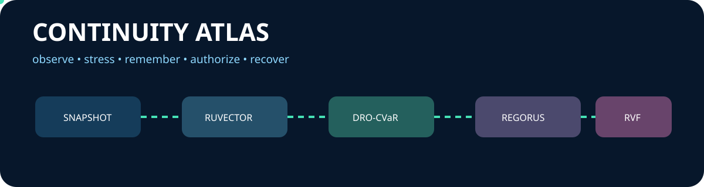
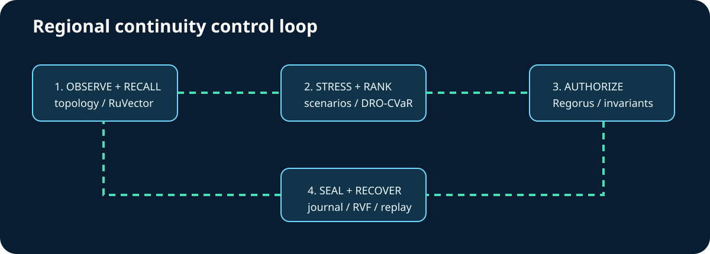

<div align="center">

# Continuity Atlas

**Distributionally robust regional failover planning with policy and replay evidence**

&nbsp;&nbsp;

</div>



Continuity Atlas helps SREs choose a survivable regional failover plan when telemetry and capacity are uncertain. It reconstructs dependencies, recalls analogous incidents with RuVector, ranks plans using Wasserstein robust CVaR, enforces Rego policy through Microsoft Regorus, seals the decision with RVF, and replays recovery while preserving tier-0 services.

## Quickstart

```bash
cargo run --locked -p ca-cli -- --input fixtures/incident.json --state target/demo
bash scripts/run-evaluation.sh
```

## Architecture



The 22 linked crates span Fleet Knowledge, Uncertainty Lab, Continuity Control, Incident Memory, Evidence & Recovery, and Runtime & Evaluation. See [architecture](docs/architecture.md) and the [implementation contract](docs/implementation-contract.md).

## Executed composition

| Ingredient | Responsibility | Ablation |
|---|---|---|
| Microsoft Regorus 0.13.0 | real Rego allow/deny | unsafe tier-0 action admitted |
| RuVector 2.4.0 | persistent analogue insert/search | recall becomes false |
| RVF crypto 0.2.0 | witness creation/verification | evidence becomes unverifiable |
| Wasserstein DRO-CVaR | ambiguity-aware tail ranking | robust control and stress advantage disappear |

Exact pins, licenses, APIs, tests, and sources are in the [integration matrix](docs/integration-matrix.md).

## Evaluation

The frozen seed is `20261017`. `evidence/evaluation.jsonl` records combined, Ruvnet-only, enterprise-only, and each ingredient ablation. No metric is fabricated: regenerate it with the script above.

| Mode | Recall | Unsafe candidate rejected | RVF verified | Robust control | Objective upper bound |
|---|---:|---:|---:|---:|---:|
| combined | yes | yes | yes | yes | 8.75 |
| without RuVector | no | yes | yes | yes | 8.75 |
| without RVF | yes | yes | no | yes | 8.75 |
| without Regorus | yes | no | yes | yes | 8.75 |
| without DRO | yes | yes | yes | no | 8.00 |
| enterprise-only | no | yes | no | no | 8.00 |
| Ruvnet-only | yes | no | yes | no | 8.00 |

A normal invocation selects `hold`, recalls one analogue, rejects the unsafe tier-0 candidate, verifies a six-event RVF witness journal, and replays recovery with tier-0 preservation. These are fixture results, not production claims.

## Maturity and limitations

Experimental advisory control plane, not a live cloud traffic director. The fixture is synthetic; vectors are deterministic incident features; the Wasserstein radius is explicit; Regorus authority is advisory; local state is single-process.

## Design and evidence

[Specification](docs/specification.md) · [Research](docs/research.md) · [ADRs](docs/adrs/README.md) · [DDD](docs/ddd/README.md) · [Guidance map](docs/core-memory-guidance-map.md) · [Validation plan](docs/design/validation-plan.md)

Technology marks come from the maintained [Simple Icons](https://simpleicons.org/) family under CC0-1.0; product names and marks remain the property of their respective owners. See [asset attribution](docs/assets/ATTRIBUTION.md).
